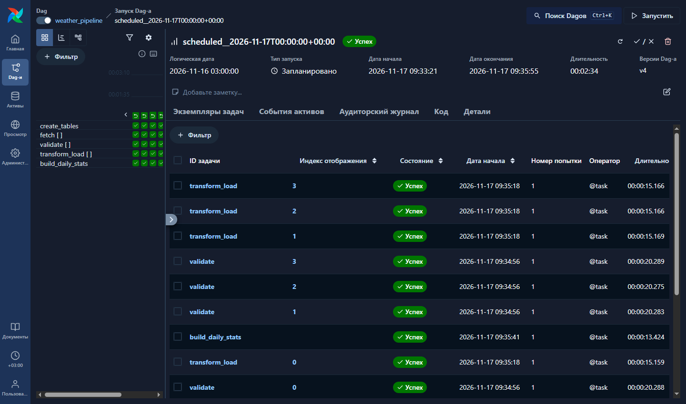

# Airflow Weather

Собрал пайплайн, который каждый день загружает погоду из Open-Meteo для Казани, Иннополиса, Москвы и Санкт-Петербурга. На этих данных сравнил несколько способов предсказать среднюю температуру на следующие сутки.

## Как идут данные

```text
create_tables → fetch × 4 → validate × 4 → transform_load × 4 → build_daily_stats
```

Airflow запускает загрузку по каждому городу. Исходный ответ API идёт в `raw_weather`. После проверки всех 24 часов UTC данные записываются в `hourly_weather`. Из них SQL-запрос считает `daily_stats`. Повторный запуск за ту же дату обновляет существующие записи.

Через backfill загрузил год истории. В базе **35 040 почасовых записей** и **1 460 дневных сводок**. [Отчёт о загрузке](backfill-report.md)



## Прогноз

Сравнил Ridge с простым прогнозом «завтра как сегодня». Использовал дневные сводки, температуру вечером и её изменение за 6 и 12 часов. Добавление четверти предсказанного изменения к бейзлайну снизило среднюю MAE на семи временных окнах с 1,615 до 1,558 °C. [Отчёт по моделям](ml/report.md)

## Как запустить

Нужен Docker Compose. При первом запуске скопируй шаблон из корня проекта.

```powershell
Copy-Item .env.example .env
```

На Linux и macOS можно использовать `cp .env.example .env`. В `.env` задай свои пароли и JWT-секрет. На Linux также укажи свой `AIRFLOW_UID`.

```bash
docker compose up -d
```

Открой Airflow и сними `weather_pipeline` с паузы. [Веб-интерфейс Airflow](http://127.0.0.1:8080)

Команды для тестов и остановки проекта.

```bash
docker compose exec airflow-scheduler python -m pytest /opt/airflow/tests
docker compose stop
```

Скрипты обучения лежат в `ml/`. Команды и SQL для выгрузки данных есть в [отчёте по моделям](ml/report.md).
